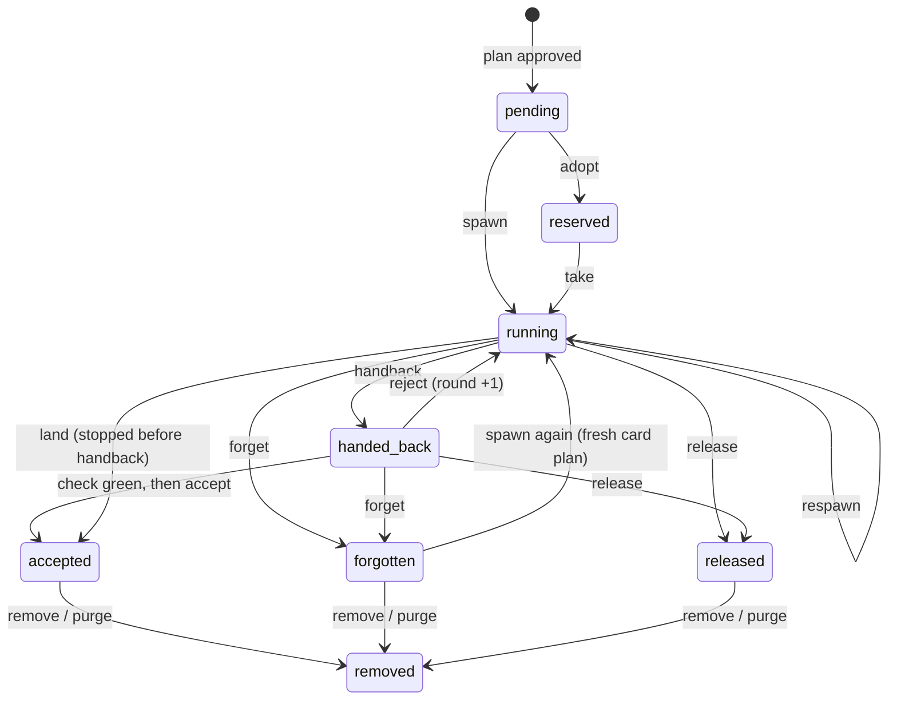

# 05 - Orchestra mode (delegated plans with child sessions)

> The user's spec, saved as pasted on 2026-11-16, in four files (this one: sections 1 to 7; then
> `05-orchestra-2.md` 8-13, `05-orchestra-3.md` 14-21, `05-orchestra-4.md` 22). It describes orchestra mode on one PC.
> How this cloud harness builds it, and what it changes, is in `05b-orchestra-cloud.md`.
> Replaced in the cloud by `system.md` (PRs 61 to 81): section 4's merge at accept (accept makes the draft PR ready;
> land merges into the plan branch, then form 2), section 7's `inbox` (signed orders), 7.1's purge (form 2 archives).

This document explains orchestra mode completely, for a reader who has never opened the code. Every rule, limit, state,
message and ordering decision is spelled out here. Nothing is left to "see the source".

## 1. What orchestra mode is, in one paragraph

A user asks for a piece of work that splits into independent parts. The session the user talks to becomes the
**orchestrator** (the **parent**). It writes one plan that lists every part as a **child** with a short task card. The
user approves that plan **once**. The parent then starts one background Claude Code session per child. Each child works
alone on its own copy of the code, proves its part with tests, commits, and sends back a structured report. The parent
does not read the children's code. It checks each child mechanically: are all its acceptance criteria covered by
registered tests, and do those tests pass again where the child worked? A child that passes is merged into the main branch.
A child that fails is sent back with a reason, up to three times. When every child has ended and nothing in the plan is
left uncovered, the plan closes as delivered with no further question to the user. Everything (plans, children, reports,
checks, questions, messages) is stored in the harness's database (the **ledger**), so the run survives restarts and can be
audited later.

### When to use it, and when not

| Use it | Do not use it |
|---|---|
| The work splits into parts that can run side by side, each on its own project (unit) or each in its own worktree of the same repository | One project, one session: an ordinary plan is cheaper |
| The user says "split this across sessions", "delegate", "run these in parallel" | Handing this session's own work to another session: that is a transfer, not orchestration |
| Each part can be judged done by tests the part itself writes | A part whose "done" only a human can judge (UI look, a business decision) |

Each child costs as much quota as a full session. Split into as many parts as the work really has, no more.

## 2. Vocabulary

Every term below is used with exactly this meaning in the rest of the document.

| Term | Meaning |
|---|---|
| Session | One Claude Code conversation. It has a session id (a long hexadecimal id) and a display name. |
| Background session | A session started by the command line in the background, with no terminal attached; it runs until it stops or is stopped. |
| Ledger | The harness's single database. All state of plans, tickets, children, behaviours, verifies and audits lives there. |
| Plan | A structured description of a change (title, overview, files, tests, steps). It must be approved before any file is edited. |
| Approval form | The question the user answers in the chat. Only the user's "Approve" there approves a plan; a word in the chat or a message from another session approves nothing. |
| Ticket | The ledger record of one session's current work: which plan is in force, its phase, its commits, its state (open or closed) and why it closed. |
| Delegated plan | A plan that carries a `children` list. Approving it creates a delegated ticket for the parent. |
| Parent / orchestrator | The session that presented and owns the delegated plan. |
| Child | One entry of the `children` list, and the session that does that entry's work. |
| Card | The task description of one child inside the delegated plan: name, unit, goal, acceptance criteria, files to read, change and test, optional session to adopt, optional push permission. |
| Unit | A project (repository) the harness knows by name. The harness's own repository is called **home**. |
| Acceptance criterion (AC) | One short, checkable sentence that says when the child's work is right. Numbered AC1, AC2, ... |
| Behaviour | A ledger record that ties a piece of expected behaviour to one or more test files. Children register one behaviour per AC. |
| Grant | What the user approves for the children: the list of cards, the units they may touch, the number of children, and any extra permissions. |
| Crew | The parent's live list of started children, kept on the parent's ticket. One **crew entry** per child. |
| Card plan | A plan generated automatically from a card that names files to change; the child opens it instead of writing its own. |
| Worktree | A second checkout of the same git repository in another folder, on its own branch. Each plan with a worktree works on its own branch (named after the plan number) so parallel children never touch each other's files. |
| Base branch | The branch a worktree starts from and merges back into (for the home, the harness's local branch). |
| Verify | The project's full test run, recorded in the ledger as green (ok) or red per session. |
| Handback | The child's final structured report. |
| Check | The parent's mechanical test of a child's work against its AC. |
| Accept | The parent's decision that a child is done: merge its branch and end it. |
| Reject | Sending a child back with a reason; one **round**. |
| Watch | A background command that waits, without using the model, until every started child has stopped, then wakes the parent once. |
| Digest | The one summary the watch prints when it ends: one line per child. |
| Release (of the harness) | The published version of the harness code that running sessions actually execute. A merge into the home's base branch may publish a new release. |

## 3. Design principles (the "why" behind every rule)

1. **One approval.** The user approves the whole delegated plan once. Children never ask the user anything; nothing a child
   says can approve or widen anything.
2. **The parent reads no code.** It judges a child by counting registered behaviours per AC and running their tests again.
   It reads a child's diff only when the change touches a guard, a gate, a deletion or the wake-up mechanism, and then
   only the code lines.
3. **Nobody is at a child's keyboard.** Anything that would wait for a human in a child must be refused or redirected,
   otherwise the child hangs for ever.
4. **All state in the ledger.** The crew, the story of every child, the questions, the queued messages, the checks and
   the handbacks are ledger rows. A restart of any session loses nothing.
5. **Every refusal comes before a side effect.** An action that starts a session, creates a worktree or merges a branch
   checks every condition first. If the ledger write after the side effect fails, the side effect is undone (for
   example, a just-started session is stopped).
6. **One digest, not a message per child.** Children never message the parent to say they are done; the watch wakes the
   parent once with everything.
7. **Limits come from incidents.** Every number in section 21 exists because something broke without it.

## 4. The whole run, end to end

```mermaid
sequenceDiagram
    participant U as User
    participant P as Parent session
    participant H as Harness (ledger, worktrees)
    participant C as Child session (background)
    P->>H: present the plan with a children list
    H-->>U: approval form
    U->>H: "Approve"
    H->>H: delegated ticket, a "pending" story row per child, a waiting card plan per card with files to change
    P->>H: spawn (name, reportTo)
    H->>C: start a background session; its first prompt is the brief
    C->>H: first prompt binds the session to its card
    C->>H: take: its card plan opens, its worktree is made
    loop work
        C->>H: write tests, register behaviours, verify, commit in its worktree
        C-->>H: ask (optional): the watch wakes the parent at once
        P->>H: answer (name, text): delivered to the child
    end
    C->>H: handback (structured report); the child stops
    P->>H: watch (in the background, no model)
    H-->>P: one digest when every started child has stopped
    P->>H: check (name)
    alt an AC not covered, a test red, or uncommitted files
        P->>H: reject (name, why): round n of 3, the reason reaches the child
    else green
        P->>H: accept (name): merge the branch, end the child, end its plan
    end
    H->>H: last accept, every child ended, nothing uncovered: the parent plan closes as delivered
```

In words:

1. The parent presents a plan with a `children` list. The user approves it once.
2. Approval creates the delegated ticket, one "pending" record per child, and, for each card that names files to change,
   a ready-made card plan waiting to be picked up.
3. The parent starts each child (`spawn`), or takes an already open session as a child (`adopt`).
4. Each child binds itself to its card, opens its card plan (which creates its worktree), works, and hands back.
5. The parent waits once with the watch, reads the digest, checks each stopped child, then accepts or rejects it.
6. When the last child is accepted and nothing is left uncovered, the parent plan closes by itself.
7. The parent removes the finished child sessions after the user ticks them in one checklist.

## 5. Writing the delegated plan: the card

The parent presents an ordinary plan with one more item, `children`: a list of cards. In the plan text the user sees, each
card is one line:

```
- <name>: <goal> | unit: <unit or home> | ac: <criterion>; <criterion> | read: <paths> | change: <paths> | tests: <paths> | session: <name> | actions: push
```

### 5.1 Fields and every rule the harness enforces

| Field | Required | Rule |
|---|---|---|
| name | yes | Lower-case letters, digits and dashes, starting with a letter or digit, at most 40 characters. Unique in the plan. It becomes the session's name. |
| unit | yes | A declared unit, or `home` for the harness repository. One child per unit, unless worktrees are switched on for that unit (or for the home), in which case several children may share it, each in its own worktree. |
| goal | yes | One sentence, at most 200 characters. A `\|` is turned into `/`. One goal per child: a goal joined with "and" draws a warning. |
| ac | yes | 1 to 6 criteria, each at most 120 characters. `;` and `\|` inside a criterion become `, `. Each must contain at least two **content words**, words that are not filler. Filler words are: it, is, are, the, a, an, all, works, work, working, done, ok, okay, good, fine, correct, correctly, properly, pass, passes, passed, passing, test, tests, goal, goals, holds, hold, as, expected, complete, completed, implemented, met, satisfied, finished, success, successful, successfully, green, and, be, to, should, must, was, now. "It works as expected" is refused: "names no real case: say what the user or a test sees (an input and its result)". |
| read | no | Paths of files the child should read. Paths only, never content. At most 8. |
| change | no | Paths of files the child will change. At most 8. **A card with `change` gets a ready-made card plan**; a card without it makes the child write and present its own plan. |
| tests | no | Paths of test files that prove the work. At most 8. The first one is attached to every AC behaviour of the card plan. |
| session | no | The name of an already open session to adopt instead of starting a new one. Letters, digits, space, dot, underscore and dash, at most 60 characters. A session may be named by only one card (compared without case). |
| actions | no | Extra permissions. The only one allowed is `push` (the child may push and open a merge request, still asking as usual). |

A path is accepted when it contains a `/` or ends with an extension, and has no space. Duplicate paths are dropped.

All faults are reported at once, so the parent fixes the plan in one round.

### 5.2 What the user actually approves: the grant

From the cards the harness builds the **grant**:

- the units the children may touch (every unit named by a card, except `home`);
- the number of children;
- a copy of every card;
- no extra actions beyond what each card lists.

The change and test paths of every card are added to the parent plan's own file and test lists when the plan opens. The
parent plan therefore "allows" every file a child will touch, and the parent's own commit gates do not refuse them.

### 5.3 Files the parent keeps for itself

The parent plan may name files no card covers (for example a document the parent writes at the end). A card **covers** a
file when one of its change or test paths is equal to it, is a folder (ending in `/`) that contains it, or is a wildcard
pattern that matches it. Files that no card covers, and that no child handed back as changed, are the parent's own work.
They decide when the parent may close (section 16).

### 5.4 One delegated plan at a time

While a delegated plan is open in a session, that session may not present or approve any other plan. The refusal says:
finish this one first (children hand back, then close), or revise it. A **revision** of the running delegated plan is
allowed (section 19). This rule exists because approving another plan used to close the delegated plan and orphan its
children.

### 5.5 How many children

- The orchestrate skill says at most 4 children per plan. At presentation time the harness does not count them; the limit
  of 4 is enforced only when an extra child is added (section 8.3).
- At most **3 children may be running at the same time** (section 8.1). Eight children running the full test suite at
  once once exhausted a 15 GB machine.

## 6. What approval does

When the user approves the delegated plan, in one database transaction:

1. The parent's ticket becomes a **delegated ticket**. It holds the grant and an empty crew (or the crew of the previous
   revision, when this approval is a revision; see section 19).
2. For each child that is not already in the crew and has no story record for this plan yet, a story record in state
   **pending** is written. This is the explicit record of "approved but not started".
3. For each card that names files to change, a **card plan** is generated and kept waiting under a key made of the plan
   number and the child name (the child's real session id is not known yet). The card plan is a full, normal plan:

| Card plan item | Content |
|---|---|
| title | the goal, cut to 80 characters |
| overview | problem and need = the goal; accept = the AC; how = "change <files>" and "prove it with <tests>" |
| code entries | one per change file, reason "the parent plan names this file for the goal" |
| services | the unit (or the home) |
| files, tests | the card's change and test paths |
| one step | commit message = the goal; points "change the files of the card", "prove each AC with a registered test" |
| behaviours | one per AC. Id: `p<parent plan number>.<child name>.ac<n>`. Description: `AC<n>: <criterion text>`. Test: the first card test when given. |
| fixed points | checks "the registered tests of each AC pass in verify"; assumption "the card of the parent plan is the whole scope"; not doing "anything outside the card"; risk "a case the AC does not name stays unchecked" |

The behaviour id contains the parent plan number and the child name because behaviours are stored across all plans:
a plain `ac1` would collide between plans.

A card without `change` gets no card plan; that child presents its own plan later (section 9.3).

## 7. The crew entry and the story of a child

Two records track each child.

**The crew entry** lives in the parent's ticket. Its fields:

| Field | Meaning |
|---|---|
| unit | the child's unit |
| bg | the background job id printed when the session was started (empty for an adopted session) |
| sid | the child's real session id, once known |
| state | see the table below |
| backs | how many times it was sent back (rounds) |
| checkedAt | the round number at which the last green check happened |
| adopted | true when the child is a session that was already open |
| model | the model it was started with, if any |
| reportSid | the parent's session id (names change on restart; the id does not) |
| sentBackAt | when it was last sent back or restarted |
| sent | every text delivered to it, with time and how |
| inbox | texts queued for it while it was busy (section 12.2) |

**The story** is an append-only table with one row per change of state: plan, child name, unit, state, round, session,
goal, AC, reason, check results, time. It also keeps the history of a child nobody remembers anymore.

### 7.1 States of a child

| State | Set by | Has it ended? |
|---|---|---|
| pending | approval (story row only; no crew entry yet) | no |
| reserved | `adopt`: an open session is booked for this child | no |
| running | `spawn`, binding, `take`, `reject` (the story row then says "rejected"), `respawn` | no |
| handed back | `handback` | no |
| accepted | `accept`, `land` | yes |
| forgotten | `forget` (the name may be started again) | yes |
| released | `release` | yes |
| removed | `remove`, `purge` | yes |



When a child ends, its own ticket closes with the same reason, and its plan gets an ending:

| Child ended as | Child's plan ends as |
|---|---|
| accepted | delivered |
| forgotten | dropped |
| removed | dropped |
| released | not ended: the child may keep working alone |
